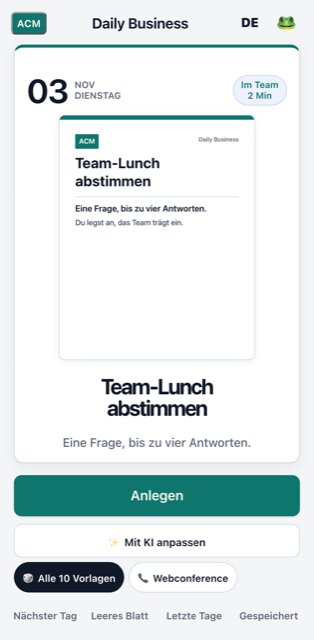
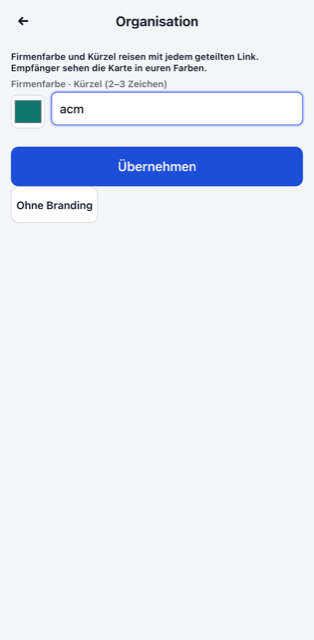
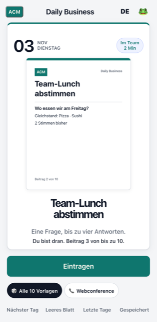
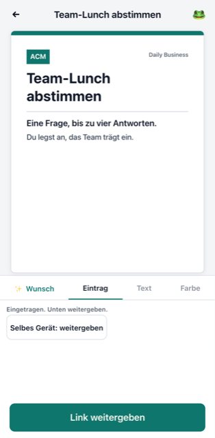
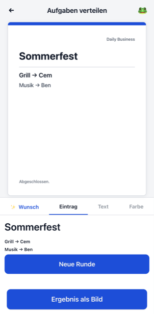
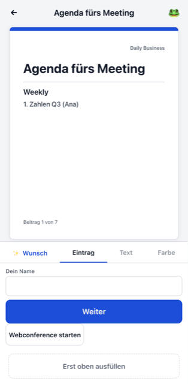

# ADR-0005: Daily Business als Build-Flavor von My Daily Idea

## Status

Angenommen (Entscheidung des Owners: Build-Flavor, Firmenfarbe und Kürzel reisen im Link).
Gebaut und getestet. Nicht deployt: Host und Pfad legt der Owner fest. Bis dahin steht in
`flavor.json` der Vorschlag `https://bunsenbrenner.org/business`.

## Kontext

My Daily Idea (`apps/duell-web`) ist ein Tagesblatt mit Karten, die per Link weiterwandern. Der
ganze Stand einer Mitmach-Karte steckt versiegelt im Link (`turns.js`, `seal`/`unseal`). Jede Karte
ist ein Eintrag in der Tabelle `GAMES` und prüft jede Antwort selbst (`okAnswer`). Welche Karten es
gibt, steht in `ideas.json`, die Wörter stehen in `texts.json` und `turn.json`, der Look in
`style.css`. `scripts/build.js` legt alles in eine einzige Offline-HTML-Datei.

Gewünscht ist dasselbe Prinzip für Erwachsene im Beruf. Dazu gehören Tageskarten, Teilen per Link,
Empfänger, die weitermachen, und der KI-Wunsch. Die Karten sind geschäftlich, der Look ist
ruhig, und es gelten andere Regeln für Profil und Zahlungen.

## Entscheidung

**Ein Build-Flavor derselben Codebasis, keine eigene App.**

```
node scripts/build.js                     -> dist/index.html           (My Daily Idea, unverändert)
node scripts/build.js --flavor business   -> dist/business/index.html  (Daily Business)
```

| Schicht | Gemeinsam | Pro Flavor (`src/flavors/business/`) |
|---|---|---|
| Engine, Link, Versiegelung, KI-Wunsch | `turns.js`, `daily.js`, `wish.js`, … | – |
| Karten-Logik | `turns.js` (termin, sammeln), `office.js` (umfrage, feedback, aufgaben, agenda) | – |
| Katalog | – | `ideas.json` ersetzt den Katalog |
| Wörter | `texts.json`, `turn.json`, `office.json` | `texts.json`, `turn.json` überschreiben einzelne Keys |
| Look | `style.css` | `style.css` wird angehängt |
| Verhalten | – | `flavor.json` → `window.DailyFlavor`, `flavor.js` wird zuletzt geladen |

Begründung:

- **Eine Karte, zwei Apps.** Termin finden und Geld einsammeln entstehen für die Jugend-App
  (Sessions termin-finden, karte-geld-einsammeln). Als Flavor laufen genau diese `GAMES`-Einträge
  auch in Business, ohne Kopie. Umgekehrt stehen Umfrage, Feedback, Aufgaben und Agenda in beiden
  Builds zur Verfügung, die Jugend-App nimmt sie nur nicht in ihren Katalog auf.
- **Getrennte Auslieferung.** Jede App ist eine eigene Datei mit eigenem Katalog, Titel und Pfad.
  Jugendschutz und Zahlungsregeln liegen nicht in derselben Datei wie die Business-Variante. Das
  wäre bei einem Laufzeit-Schalter (`?org=…`) der Fall.
- **Kleine Eingriffe in gemeinsame Dateien.** `app.js`: Der Flavor wählt die Funktionsleiste
  (1 Zeile). `core.js`: Der Teilen-Pfad kommt aus dem Flavor (1 Zeile). `turns.js`: `bad()` sieht die
  bisherigen Züge (1 Zeile). Dazu kommen zwei Platzhalter im Template.
- **Karten, die erst ein anderer Branch bringt** (termin, sammeln), stehen schon im Business-Katalog.
  Der Build lässt sie weg, solange `GAMES` sie nicht kennt, und nimmt sie nach dem Merge
  automatisch auf.

### Organisation: Farbe und Kürzel im Link

Firmenfarbe und 1–3 Zeichen Kürzel reisen als Feld `o` neben der Karte im `c=`-Link
(`{v:1, d:…, o:{c:"#0f766e", n:"ACM"}}`). Die Jugend-App ignoriert das Feld. Es gibt keinen Server,
keinen Upload und keine CSP-Änderung. Wer einen Link bekommt, sieht Karte, Kopfzeile und Knöpfe in
den Farben des Absenders. Wer selbst eine Organisation eingestellt hat (Logo-Knopf oben links,
gespeichert nur auf dem Gerät), teilt in eigenen Farben. Passt das Feld nicht mehr unter
`MAX_FRAGMENT`, geht der Link ohne Farben raus. Die Karte hat Vorrang.

### Regeln für Erwachsene

| Thema | Jugend-App | Business |
|---|---|---|
| Betrag beim Geld-Einsammeln | 1–50 € | 1–500 € (`flavor.json: eur`). Wirkt, sobald `sammeln` den Wert liest (abgestimmt mit karte-geld-einsammeln). |
| Namen in Karten | Spitzname | Vor- oder Nachname bis 16 Zeichen |
| Feedback | – | ohne Namen. Gespeichert werden nur Note und optionaler Satz. |
| Freitext | Filter `Quest.clean` (keine Telefonnummern, Adressen, Handles) | Derselbe Filter gilt. Auch eine Firmenkarte soll keine Kontaktdaten weitertragen. |
| Zahlungen | Nur ein PayPal.me-Link. Das Geld läuft nie über uns. | Unverändert. Es gibt keine Konten und keine Zahlungsdaten in der App. |

## Karten (Stand dieses Branches)

| Karte | Logik | Bis zu | Ende |
|---|---|---|---|
| Umfrage/Abstimmung | `office.js: umfrage` | 10 Stimmen, 2–4 Antworten, jeder Name einmal | Nach der 10. Stimme. Der Stand ist vorher jederzeit auf der Karte. |
| Feedback einholen | `office.js: feedback` | 6 Rückmeldungen, Note 1–5, optionaler Satz | Nach der 6. Rückmeldung |
| Aufgaben verteilen | `office.js: aufgaben` | 2–5 Aufgaben, jede nur einmal | Wenn keine mehr offen ist |
| Meeting-Agenda + Webconference | `office.js: agenda` | 3 Startpunkte plus 6 Beiträge | Nach dem 6. Beitrag. „Webconference starten“ ab dem ersten Eintrag. |
| Termin finden | `turns.js: termin` (Branch feat/duell-terminfinder) | – | kommt mit dem Merge |
| Geld einsammeln | `turns.js: sammeln` (Branch feat/duell-geld-einsammeln) | – | kommt mit dem Merge |

Die Grenzen sind gemessen. Voll belegt mit den längsten Eingaben bleibt jede Karte unter
`MAX_FRAGMENT`, mit Platz für die Firmenfarbe (`test/office.test.js`).

## Entwurf

| Start mit Firmenfarbe | Einstellung | Empfänger: Stand der Umfrage |
|---|---|---|
|  |  |  |

| Eintragen | Aufgaben vergeben | Agenda mit Webconference |
|---|---|---|
|  |  |  |

Die Screenshots stammen aus `test/e2e/business.e2e.js` (mit `SHOT_DIR`), Pixel 7, de-DE.

## Offen (Entscheidung des Owners)

1. **Host und Pfad** der Business-Datei. Vorschlag: `https://bunsenbrenner.org/business`
   (`flavor.json: shareBase`).
2. **Kurzlinks mit Vorschaubild.** Der Kurzlink-Server leitet `/s/<id>` auf die Jugend-App. Bis er
   ein Ziel pro App kennt, teilt Business den langen Link (`flavor.json: short: false`). Das echte
   Vorschaubild hängt am Kurzlink und fehlt Business deshalb bis dahin. Nötig ist ein Feld `a`
   (App) im `POST /api/s` und ein Ziel pro App beim Auflösen.
3. **Gemeinsamer Raum in der Webconference.** Die Webconference kennt keinen Raum per URL. Der Knopf
   öffnet sie, und verbunden wird über die eigenen Kontakte.
4. **KI-Wunsch im Business-Ton.** Der Server-Prompt ist auf Jugendliche zugeschnitten. Für Business
   braucht es eine eigene Tonlage (Feld `a` wie bei 2).
